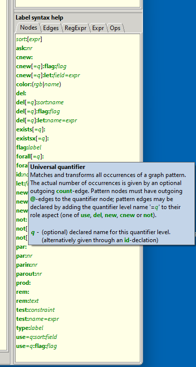
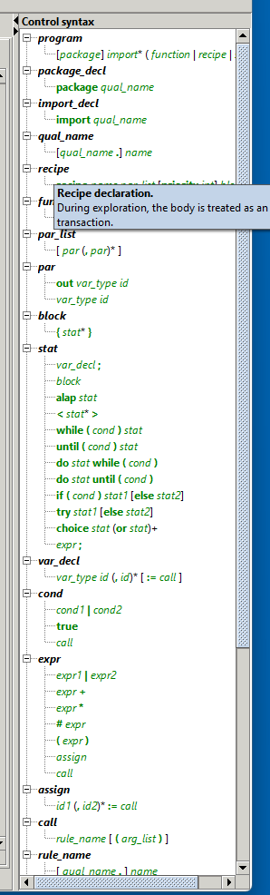


  {{site.groove_url}}{{page.usermanual_suffix}}


This is the web edition of the GROOVE user manual, which supersedes the legacy PDF manual. All chapters have been rewritten against the current feature set of the tool; the release column below records the GROOVE release that each chapter describes (see [Releases](#releases) below).

## Chapters


| Chapter | Contents | Release |
| :--- | :--- | :--- |


| [{{ chapter.title }}]({{ url }}) | {{ chapter.summary }} | {{ chapter.release }} |


## Releases

The manual describes the latest GROOVE release. The conventions are:

- Every chapter states, under its summary, the release it describes: the `release` entry in the chapter's front matter, which also feeds the table above, so the two cannot disagree. When a chapter is checked against a new release, that entry is updated.
- A feature that arrived in release 6.1.0 or later is marked *(since release x.y.z)* at its first description, with the release taken from the [change log]({{site.groove_url}}/code/blob/master/release/include/CHANGES.md); older features carry no such note.
- Behaviour that differs between releases is stated with concrete release numbers ("release 8.0.0 rejects this"), never relative to the release described ("later releases").

The generated reference pages carry the release of the source code they were generated from in their header instead.

## Reference pages

In addition to the chapters, the manual contains reference pages that are *generated from the GROOVE source code*, so they cannot drift out of date:

- [Aspect prefixes](manual_ref_prefixes.html) — the complete label syntax for host graphs, rules and type graphs
- [Data operations](manual_ref_operators.html) — all built-in operations on the data sorts
- [Control grammar](manual_ref_control.html) — the full grammar of the control language
- [Strategies and acceptors](manual_ref_exploration.html) — the named vocabulary of the legacy exploration options

## Legacy PDF documents

The previous edition of the user manual consists of two PDF documents, both quite outdated with respect to the current feature set:

- [Full user manual]({{usermanual_url}}/usermanual.pdf)
- [Quick reference chart]({{usermanual_url}}/quick-reference.pdf)

## Help within the tool

Further help is available within the Simulator tool: when editing graphs or control programs, the right-hand side panel displays a range of options. Hovering on the options gives you further information about how to use them. Here are two example screenshots:

| Graph editor prefixes | Control language grammar |
|    :-------------------:     |  :---:  |
| &emsp;  &emsp; | &emsp;  &emsp; |
